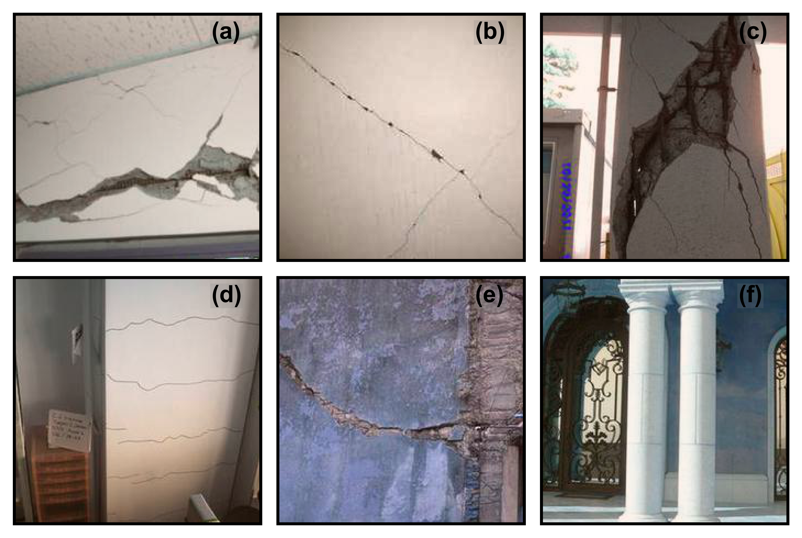
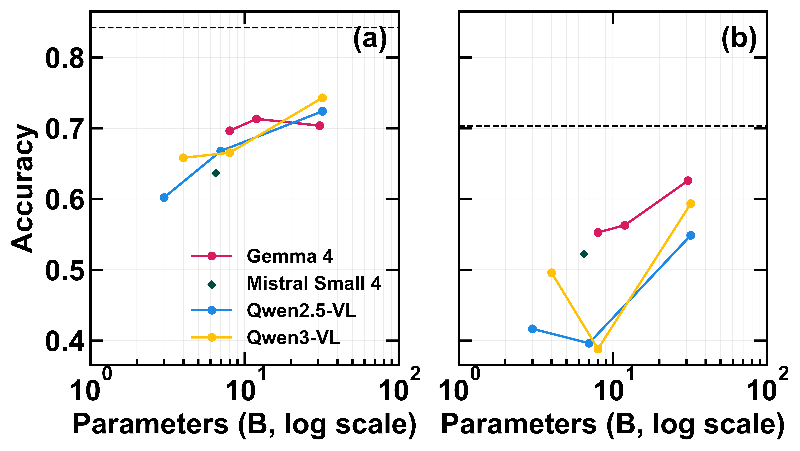

# Benchmarking vision-language models for structural damage classification

Zero-shot open-weight vision-language models can recognise concrete spalling in post-earthquake photographs, and they still fall short of classifying the damage mechanism. On the official [PEER Hub ImageNet](https://doi.org/10.1061/(ASCE)ST.1943-541X.0002745) test splits, the best of ten models reaches $0.743$ accuracy on spalling and $0.626$ on mechanism, behind a supervised PEER ResNet-50 at $0.842$ and $0.703$.

## What we built

We built a zero-shot benchmark that asks general-purpose VLMs to name structural damage from a photograph and a class definition, with no task-specific training. The evaluation uses two official PEER tasks that isolate different visual judgements. Task 3 is binary spalling detection (spalling versus non-spalling; $837$ test images). Task 8 is four-way damage mechanism: flexure, shear, combined flexure-shear, and undamaged ($492$ test images). The roster is ten open-weight models from four families: Qwen2.5-VL (3B, 7B, 32B), Qwen3-VL (4B, 8B, 32B), Gemma 4 (E4B, 12B, 31B), and Mistral Small 4 (119B total, 6.5B active). The reference is the supervised PEER ResNet-50 shipped with the dataset, scored on the same test images.

*Figure 1. Representative test images. Spalling is a change in surface appearance. Mechanism labels depend on crack direction relative to the member.*

## How

Every model sees the same definition-grounded prompt, the same image encoding, and a greedy decode through [vLLM](https://github.com/vllm-project/vllm). The response is parsed as a single class token. Abstention is recorded and is zero on both tasks. We report accuracy and macro-F1, with percentile bootstrap 95% confidence intervals over $1{,}000$ resamples of the test set. Macro-F1 is the unweighted mean of per-class F1 scores, so a model that is carried by the majority class is visible even when raw accuracy looks acceptable.

## What we found

Spalling is the easier judgement for every VLM and for the CNN. Qwen3-VL-32B is the best zero-shot model on Task 3, at $0.743$ accuracy (95% CI $0.713$–$0.773$) and $0.733$ macro-F1, about $0.10$ below the PEER ResNet-50. Mean accuracy across the ten models is $0.681$, well above the $0.5$ chance level, and accuracy and macro-F1 stay close, so both classes are being recovered.

Damage mechanism is much harder. Gemma-4-31B is the best model on Task 8, at $0.626$ accuracy (95% CI $0.585$–$0.669$) but only $0.520$ macro-F1, against PEER ResNet-50 accuracy $0.703$ and macro-F1 $0.594$. Mean VLM accuracy is $0.510$. The gap is class-specific: for the best VLM, F1 is $0.798$ on undamaged and $0.603$ on combined damage, and only $0.427$ on shear and $0.252$ on flexure. Flexure is the class that requires thin cracks to be read against the member axis.

*Figure 2. Accuracy (solid) and macro-F1 (translucent). The last pair of bars on each panel is the supervised PEER ResNet-50.*

Scaling inside a family does not close the gap. Accuracy moves only modestly with parameter count, confidence intervals within a family overlap, and Mistral Small 4, plotted at its $6.5$B active count, follows the same pattern. The limit is the cue the models fail to use, not the number of parameters.

*Figure 3. Accuracy versus parameter count. Mistral Small 4 is shown at its active size, with total capacity annotated.*

The remaining errors are shared. On Task 3, about $5\%$ of images are missed by all ten models. On Task 8 that share is about $13\%$. Pairwise agreement is high within a family and often high across families, so the models tend to assign the same wrong label. A different off-the-shelf VLM of the same type will not fix the photographs they all miss.

*Figure 4. Shared outcomes. (a, c) Images classified correctly by exactly $k$ of the ten models. (b, d) Pairwise agreement: the fraction of images on which two models predict the same class.*

General-purpose VLMs are closer to usable for appearance-level spalling triage than for mechanism-level assessment, which should not yet feed engineering decisions. The useful next step on Task 8 is more labelled flexure and shear examples, and captions that name crack direction on the member, rather than a larger model from the same families. This pass used one prompt, open-weight models only, and the curated PEER photographs, so a prompt study and a check on raw reconnaissance imagery are the immediate follow-ups.
